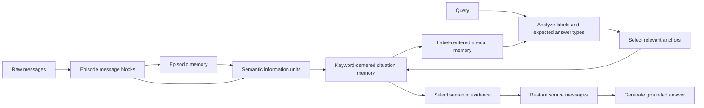

# WorldMem

**WorldMem: A Cognitively Inspired Memory Framework for Long-Term LLM Agents**

Anonymous research implementation. WorldMem (WMem) constructs an internal model
of an agent's interaction environment and uses that model to retrieve evidence
for answering questions. It supports **LoCoMo** and **PerLTQA**, with in-process
Hugging Face models, a separate vLLM server, or GPT-5-nano through an
OpenAI-compatible Chat Completions endpoint.

## Memory architecture

| Level | Representation | Purpose |
| --- | --- | --- |
| L4 | Message blocks | Preserve the original interaction, segmented by episode. |
| L3 | Episodic and semantic memory | Summarize events and extract useful information units with source pointers. |
| L2 | Situation memory | Connect semantic memories across episodes around a recurring keyword or anchor, in temporal order. |
| L1 | Mental memory | Organize anchors under reusable high-level labels, adding labels when new information types appear. |

There are four conceptual levels and five JSONL record types: episodes and
semantics share L3. Mental memory replaces the older Theme terminology;
Situation memory is distinct from individual semantic information units.



Construction retains the active research procedures: episode segmentation,
prediction/correction-based semantic extraction for LoCoMo, message-level atomic
backfilling, keyword and label annotation, label normalization and expansion,
cross-episode situation assembly, and mental label buckets. PerLTQA uses its
structured profile, social, event, and dialogue sections through a dedicated
adapter.

Retrieval proceeds through query analysis, anchor selection, situation evidence
selection, and source-grounded answering. The final scripts also use a bounded
global semantic similarity supplement. Character and Time labels are retained
in Mental memory but excluded as standalone Situation anchors by the construction
policy. The two ablations remove Mental or Situation retrieval respectively.

## Install and verify on a CPU machine

Python **3.12+** is required. Run commands from this repository directory.

```bash
python -m venv .venv
source .venv/bin/activate
export HF_HOME="$PWD/.cache/huggingface"
export XDG_CACHE_HOME="$PWD/.cache"
python -m pip install -e .
python -m worldmem demo
```

The demo uses fictional museum-visit messages, scripted model responses, and
deterministic hash embeddings. It creates all five memory files under
`outputs/demo/memories/` and an answer with evidence in `outputs/demo/answer.json`.
It requires no model downloads, API keys, or GPU. **It verifies the pipeline and
does not measure memory quality.** Hash embeddings are for synthetic tests only.

For real local sentence embeddings, install `.[embeddings]`. For in-process
Qwen inference, install `.[hf]`. Install `.[vllm]` in a GPU serving environment;
vLLM and Transformers environments can be separate. GPU dependencies and model
weights are optional and are not bundled with this release.

```bash
python -m pip install -e '.[dev,eval]'
python -m pytest -q
python -m ruff check src tests scripts
```

## Datasets

Obtain the datasets from [LoCoMo](https://github.com/snap-research/locomo) and
[PerLTQA](https://github.com/Elvin-Yiming-Du/PerLTQA), respecting their licenses.
Place them under the ignored `data/` directory or pass their paths explicitly.
Only fictional examples are included in `examples/`.

| Dataset | Build input | Retrieval/evaluation input |
| --- | --- | --- |
| LoCoMo | `locomo10.json`, containing `conversation` | The same file, using its `qa` records |
| PerLTQA, English v2 | `perltmem_en_v2.json` | The separate `perltqa_en_v2.json` |

LoCoMo uses the owner ID `<speaker_a>_<conversation_index>`. PerLTQA defaults to
`<protagonist>_<character_key>`, following the selected build scripts. An
`owners.json` manifest records both the dataset key and protagonist name so the
QA file resolves to the same memory even when its keys differ. Ambiguous matches
raise an error. Do not reorder or slice a LoCoMo dataset before retrieval; use
`--limit` and `--qa-limit` to preserve owner indices. See
[dataset formats](docs/datasets.md) for accepted layouts.

## Choose an experiment preset

| Preset | Build backend | Retrieval backend | Retrieval implementation |
| --- | --- | --- | --- |
| `configs/locomo_qwen.json` | Hugging Face Qwen3-8B | vLLM | LoCoMo semantic-budget variant |
| `configs/locomo_api.json` | GPT-5-nano API | GPT-5-nano API | LoCoMo external-API variant |
| `configs/perltqa_qwen.json` | vLLM Qwen3-8B | vLLM | PerLTQA v7 global supplement |
| `configs/perltqa_api.json` | GPT-5-nano API | GPT-5-nano API | PerLTQA GPT reasoning v2 |

Presets specify model IDs, memory directories, embedding settings, reasoning
policies, and retrieval budgets. Embeddings default to
`sentence-transformers/all-MiniLM-L6-v2` on CPU; use `--embedding-device cuda` on
a GPU client. A local path is accepted wherever a model ID is accepted.

The supplied presets preserve the selected scripts' retrieval defaults, with
portable model IDs and conservative worker counts. The paper and executable
defaults differ in several budgets and in the PerLTQA GPT final reasoning effort.
[The extraction notes](docs/extraction.md) give the exact differences. This
release does not claim that historical paper scores have been rerun.

## GPT-5-nano on a CPU client

Install `.[embeddings]`, copy `.env.example` to `.env`, and set `OPENAI_API_KEY`.
For a compatible gateway, also set `OPENAI_BASE_URL`. `.env` is read only from
the current repository directory and is ignored by Git. No API key is stored in
configuration JSON. The following commands make real API calls.

```bash
python -m worldmem build --config configs/locomo_api.json \
  --data data/locomo10.json

python -m worldmem retrieve --config configs/locomo_api.json \
  --data data/locomo10.json --output outputs/locomo_api/answers.full.json

python -m worldmem build --config configs/perltqa_api.json \
  --data data/perltmem_en_v2.json

python -m worldmem retrieve --config configs/perltqa_api.json \
  --data data/perltqa_en_v2.json --output outputs/perltqa_api/answers.full.json
```

Use `--limit 1` and, for retrieval, `--qa-limit 2` for a small real-model trial.
LoCoMo additionally accepts `--session-limit` during construction. Such limits
are smoke-test settings and should be omitted for full experiments.

GPT requests use `max_completion_tokens` and stage-specific `reasoning_effort`;
local sampling parameters are sent only to the local model backend. Reasoning
tokens count toward the GPT completion budget. See the
[official Chat Completions reference](https://developers.openai.com/api/reference/resources/chat/subresources/completions/methods/create).

## Qwen: model startup and execution

**Hugging Face inference loads the model inside the build or query process.**
There is no model-server startup step for `--backend hf`. The client uses BF16
and SDPA on a GPU, or FP32 when explicitly running on CPU. An 8B model on CPU
requires substantial RAM and is slow; the CPU client can instead call a GPU
server through the network.

**vLLM must be started separately.** Neither construction nor retrieval launches
or stops a server. On the GPU machine:

```bash
python -m pip install -e '.[vllm]'
CUDA_VISIBLE_DEVICES=0 bash scripts/serve_vllm.sh
```

The launcher serves `Qwen/Qwen3-8B` as `Qwen3-8B` at
`http://127.0.0.1:8000/v1`. `MODEL_ID`, `SERVED_MODEL_NAME`, `PORT`,
`MAX_MODEL_LEN`, `TENSOR_PARALLEL_SIZE`, and `GPU_MEMORY_UTILIZATION` are
configurable environment variables. Extra arguments are passed to `vllm serve`.
For access from another machine, configure the serving bind address and your
network route, then pass `--base-url http://MODEL_HOST:8000/v1` to the client.
The context limit must accommodate both the prompt and requested output.
See [Qwen's vLLM deployment guide](https://qwen.readthedocs.io/en/stable/deployment/vllm.html).

On the client:

```bash
python -m worldmem build --config configs/locomo_qwen.json \
  --data data/locomo10.json
python -m worldmem retrieve --config configs/locomo_qwen.json \
  --data data/locomo10.json --output outputs/locomo_qwen/answers.full.json

python -m worldmem build --config configs/perltqa_qwen.json \
  --data data/perltmem_en_v2.json
python -m worldmem retrieve --config configs/perltqa_qwen.json \
  --data data/perltqa_en_v2.json --output outputs/perltqa_qwen/answers.full.json
```

To build LoCoMo through vLLM too, add `--backend vllm`; to build PerLTQA with
in-process Transformers, add `--backend hf`. `--llm-model` overrides the HF model
ID/path or API served name. Qwen retrieval thinking can be enabled per stage with
the preset's `retrieval.stage_thinking` mapping. Llama-3.1-8B-Instruct can use the
same non-thinking profile with the corresponding model and served-name overrides.
The `situation_final_answer` switch expands to the factual, temporal, and inference
answer branches; explicit branch settings take precedence.

## Query, ablations, and metrics

```bash
python -m worldmem ask --config configs/locomo_api.json --owner Alice_0 \
  --query 'Which city did Alice visit?' --output outputs/query.json

python -m worldmem retrieve --config configs/locomo_qwen.json \
  --data data/locomo10.json --experiment no_mental \
  --output outputs/locomo_qwen/answers.no_mental.json

python -m pip install -e '.[eval]'
python -m worldmem score --input outputs/locomo_qwen/answers.full.json \
  --output outputs/locomo_qwen/metrics.json
```

Use `--experiment no_situation` for the other ablation. `--full-results` retains
all stage traces and source evidence alongside answers. Reference answers and QA
categories are attached after inference; they are not provided to the answering
model. LoCoMo presets select categories 1–4; `--categories` overrides the selection.

`score` preserves the previous lightweight evaluator's exact-match, token-set F1,
BLEU-1/2/3/4, and ROUGE-L definitions. These differ from the separate PerLTQA
TriMem protocol. The preserved optional TriMem evaluator, including LLM judging,
is described in [evaluation notes](docs/evaluation.md). Rule-based scoring does
not call an LLM. Retrieval token accounting is written to the adjacent `.run.json`
file, using server-reported usage when present and estimates otherwise.

Builds are staged per owner. A fingerprint and checksums prevent skipping stale
or incomplete memory. Use `--overwrite` to replace selected owners after the new
build succeeds. Retrieval saves results incrementally and skips completed queries
on resume. A changed input or preset requires a new output path or `--no-resume`.
Use a separate memory directory for each construction model; retrieval can reuse
that directory through `--memory-dir` for cross-model experiments.

The Python facade exposes the same construction and answering stages:

```python
from worldmem import MemoryConfig, WorldMem
from worldmem.clients import EmbeddingClient, LLMClient

llm = LLMClient(backend="openai_api", model="gpt-5-nano")
embeddings = EmbeddingClient()  # Requires the embeddings extra.
with WorldMem(MemoryConfig(storage_path="outputs/my-memory"),
              llm_client=llm, embedding_client=embeddings,
              profile="locomo_api") as memory:
    memory.build("example", [
        {"role": "Alice", "content": "I visited Paris yesterday.",
         "timestamp": "2023-05-08T13:56:00"}
    ])
    result = memory.ask("example", "Which city did Alice visit?")
    print(result["response"])
```

`build` accepts a fresh owner namespace. Dataset runs, transactional rebuilds,
and PerLTQA's structured adapter use the CLI/runner workflow described above.

## Repository layout

```text
configs/                 Four experiment presets
examples/                Fictional LoCoMo and PerLTQA input examples
src/worldmem/
  api.py                 Public WorldMem facade
  cli.py, runner.py       Dataset commands, checkpoints, result handling
  construction/          Shared builder and PerLTQA-specific construction
  datasets/              Dataset adapters and owner naming
  generation/            Episode/semantic generation and construction prompts
  models/                Serializable memory records and provenance fields
  prompts/               Shared and experiment-specific retrieval prompts
  retrieval/             Four final retrieval variants, with shared inheritance
  evaluation/            Offline metrics and optional TriMem evaluator
  clients.py, hf.py       API, vLLM, Transformers, and embedding clients
  storage.py             Canonical per-owner JSONL storage
scripts/                 vLLM launcher and anonymous release preparation
tests/                   CPU-only integration and API contract tests
```

No model weights, benchmark data, generated memories, `.env` files, paper PDF, or
Git history are bundled. The upstream MIT notice remains in `LICENSE`; see
`NOTICE` for attribution.

```bash
python scripts/prepare_release.py --check-only
python scripts/prepare_release.py
```

The second command produces `dist/WorldMem-anonymous.zip` from an explicit set
of source directories. The archive can be reviewed and uploaded to an anonymous
code host. Hosting-account identity and repository visibility are controlled by
the uploader.
